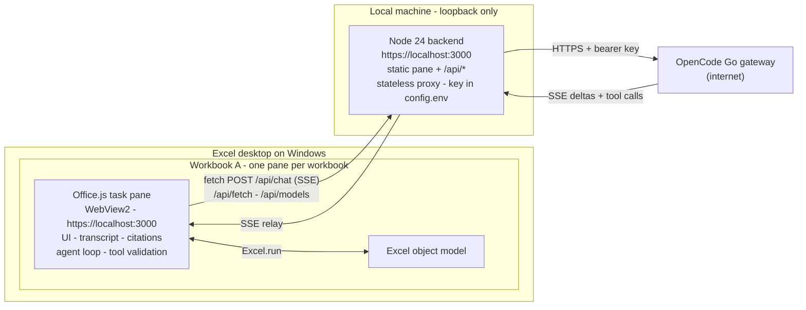
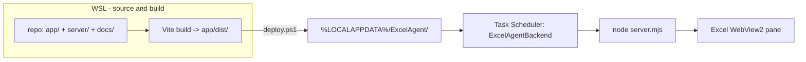

# Runtime topology

- **Status:** accepted
- **Date:** 2026-11-07
- **Ticket:** [#7 Choose the runtime topology](https://github.com/mustaphaelou/excel-agent/issues/7)

## Context

The shipped add-in is a VBA `.xlam` in Excel's XLSTART that talks to `bridge.py` in WSL over `http://127.0.0.1:8765`. The replacement is an Office.js task pane. The wayfinder research settled the [capability envelope](../wayfinder/research/01-officejs-capability-envelope.md), the [local HTTPS and sideload path](../wayfinder/research/02-local-hosting-and-sideload.md), [gateway streaming and tool calling](../wayfinder/research/03-gateway-streaming-and-tools.md), and a [working pane at `https://localhost:3000`](../wayfinder/research/06-pane-sideload-spike.md). This record fixes the runtime shape that the UX, safety, context, history and protocol tickets build on.

Constraints: one Windows machine, personal use, local-first (workbook content stays on the machine; the model gateway is the only external service), a backend that can be swapped for a hosted one later, one pane per workbook, and no standing admin requirement.

## Decision

1. **One Node 24 process on Windows** serves the pane and `/api/*` from `https://localhost:3000`, bound to `127.0.0.1` and `::1`. Python is out of the runtime; there is no Cloudflare hop. The server is plain ESM with zero runtime npm dependencies.
2. **The agent loop lives in the pane.** The pane owns the model↔tool cycle and runs Excel tools with `Excel.run`; the backend proxies model calls and web fetches and never touches the workbook. The gateway key never reaches the pane.
3. **Transport is same-origin `fetch` POST + SSE.** `/api/chat` returns `text/event-stream`; `/api/fetch` and `/api/models` are JSON. No WebSocket, no CORS, no preflight.
4. **Default task-pane runtime, not shared runtime.** Closing the pane ends the turn; history is restored from the local store ([#11](https://github.com/mustaphaelou/excel-agent/issues/11)). No `SharedRuntime` requirement and no `Runtimes` element.
5. **XML manifest + developer registry sideload.** A fixed `<Id>`, `SourceLocation = https://localhost:3000/taskpane.html`, and `HKCU\Software\Microsoft\Office\16.0\WEF\Developer\{Id}` pointing at the installed manifest. No unified manifest and no network share. `ExcelApiDesktop` and other advanced sets are runtime-checked with `isSetSupported`, never declared.
6. **Install under `%LOCALAPPDATA%\ExcelAgent\`.** `app\` (server + built pane), `cert\`, `logs\`, `history\`, `config.env`, `manifest.xml`, and `start`, `stop`, `install`, `uninstall`, `renew-cert`, `deploy` scripts. The old `.xlam` is removed from XLSTART at cutover and kept as a rollback copy; `bridge.py` and `vba\` stay in the repo as reference.
7. **Lifecycle: Task Scheduler at logon + supervisor.** `schtasks /sc onlogon /delay 0000:10 /rl LIMITED`, one elevated create. `start.cmd` refuses a double start, restarts Node with backoff on unexpected exit, exits on a bind failure, and writes `logs\server.log` with 5 MB rotation. `stop.cmd` kills by PID file. Upgrade is deploy plus restart.
8. **Certificate: install-generated CA + 825-day leaf.** The CA (10 years) goes into `CurrentUser\Root`; the leaf covers `localhost`, `127.0.0.1` and `::1`. Startup logs subject and expiry; `renew-cert.ps1` re-signs with the same CA. No 30-day development certificate.
9. **Loopback-only API with Host and Origin checks, no bearer token.** Only the three loopback host forms are accepted; POSTs require an `Origin` matching the request host and `Content-Type: application/json`; no CORS headers; `Cache-Control: no-store`.
10. **Stateless chat backend, pane-owned sessions, one local store.** The backend keeps no conversation state for chat; each `/api/chat` request is self-contained. It does own the local history store under `%LOCALAPPDATA%\ExcelAgent\history\` ([#11](https://github.com/mustaphaelou/excel-agent/issues/11)): plain JSON files, loopback-only endpoints, never proxied to a hosted backend, holding only what the pane writes. The pane sends `X-Excel-Agent-Session` for `x-opencode-session` and log correlation.
11. **Credentials in `%LOCALAPPDATA%\ExcelAgent\config.env`** with a user-only ACL; the process environment overrides for development. `install.ps1` imports the key once from WSL's `~/.dsh/.credentials.yaml` or prompts for it. The key is never logged or sent to the pane.
12. **Build in WSL, deploy to Windows.** The pane builds to `dist/` with Vite; the server is plain ESM with no runtime dependencies. `deploy.ps1` copies `dist/`, `server/`, the manifest and the scripts to the install directory and restarts. There is no `node_modules` on Windows and the repo stays the source of truth. The pane framework is [#8](https://github.com/mustaphaelou/excel-agent/issues/8)/[#13](https://github.com/mustaphaelou/excel-agent/issues/13)'s call.
13. **Reuse `bridge.py` selectively.** Port the gateway client/fallback/retry, the model catalog and cache, the web fetch with its SSRF guards, HTML-to-text and limits, and credential handling. Drop the line protocol, prompt/context builder, action conversion, `BaseHTTPRequestHandler` and the VBA two-phase gate. `bridge.py` stays untouched as the behavioural reference.

## Topology

`/api/chat` is the only streaming route. The server normalizes the gateway's OpenAI SSE frames into #12's small event stream (`start`, `text.delta`, `tool_call`, `usage`, `done`, `error`, `cancelled`); the pane consumes those events, executes any Excel tool calls, appends `role: "tool"` results, and posts the next request. Read tools run immediately; write tools wait for the pane's approval gate. This is #12's amendment to the earlier note that the pane parses raw frames; the topology is unchanged.

Build and deploy:

## Consequences

- **No WSL at runtime.** Excel startup no longer depends on a WSL distro, port forwarding or a Python process. WSL is build-time only.
- **One UAC prompt, once.** Only the Task Scheduler task creation needs elevation; the install, certificate, registry entry and files are per-user.
- **Node 24 is a runtime dependency.** It is present on this machine; `start.cmd` resolves it from `PATH` (or a configured path) and a Node upgrade is just a restart.
- **Closing the pane kills the in-flight turn.** With the default runtime the page is torn down; the transcript restores from storage on reopen, but the turn does not survive. Accepted for v1; the shared runtime is the upgrade path if background turns become a requirement.
- **Office.js still comes from Microsoft's CDN.** Workbook content stays on the machine, but the prompt context needed for an answer goes to the OpenCode Go gateway. The backend is the only component that holds the key and can be replaced by a hosted proxy without changing the pane.
- **The certificate is the top blank-pane failure mode.** The leaf expires in 825 days; startup logs its expiry and `renew-cert.ps1` re-signs without re-trusting the CA.
- **Port 3000 is a single point of failure.** The spike's task and registry entry currently own it and must be removed at cutover; a bind failure is logged and fails visibly.
- **The VBA ribbon is retired.** Rollback is restoring the `.xlam` copy; `bridge.py`, `vba/` and the built `.xlam` remain in the repo as reference.

## Rejected alternatives

| Alternative | Why rejected |
| --- | --- |
| Python backend in WSL | Reuses `bridge.py`, but couples Excel startup to WSL and localhost forwarding, splits cert and key paths across two filesystems, and still needs Node for the pane build. |
| Node in WSL | Adds the port cost and keeps the WSL fragility; no benefit over Node on Windows. |
| Cloudflare Worker or Tunnel | Makes the pane a public origin (Local Network Access/CORS to the local API); Quick Tunnel has no SSE and a changing URL; data leaves the machine. |
| Split origins (static host + local API) | CORS and preflight for every call, plus LNA from a public origin. |
| Unified JSON manifest | No v1 capability the XML manifest lacks; its Windows sideload path is less proven here, and the network-share install that would force XML is out of scope. |
| Shared runtime | A hidden runtime per open workbook, an unproven configuration in this codebase, and not needed for v1. |
| WebSocket | No gain over `fetch` + SSE; one more protocol, origin check and reconnect path. |
| Backend-owned agent loop | The backend cannot call `Excel.run`; it would need an RPC channel back into the pane and would still stall when the pane closes. |
| Windows service | Needs admin and runs as SYSTEM, where the per-user gateway key and certificate do not belong. |
| Per-launch bearer token | Marginal: a local process that can call the API can also read the token from the install directory; Origin + Host stops the browser drive-by case. |
| Keeping the VBA add-in | Two ribbons, two backends and two state models; the migration is the point. |

## Follow-ups

- [#8 Sidebar UX and visual language](https://github.com/mustaphaelou/excel-agent/issues/8) decides the pane layout, ribbon entry and auto-open behaviour.
- [#9 Edit safety and approval model](https://github.com/mustaphaelou/excel-agent/issues/9) defines the approval gate this record assumes.
- [#10 Workbook context and cell citations](https://github.com/mustaphaelou/excel-agent/issues/10) defines what the pane sends and how citations navigate.
- [#11 Conversation, history and instructions](https://github.com/mustaphaelou/excel-agent/issues/11) decides where history lives and how a workbook is identified.
- [#12 Agent protocol and Excel tool surface](https://github.com/mustaphaelou/excel-agent/issues/12) defines the tools, streaming parser details and model policy.
- The test strategy graduates from the map's fog into its own ticket, blocked by #12. Decided 2026-11-08: [#15](https://github.com/mustaphaelou/excel-agent/issues/15) / [15-test-strategy.md](../wayfinder/design/15-test-strategy.md); the harness is stood up in build phase 1.
- The clickable prototype ([#13](https://github.com/mustaphaelou/excel-agent/issues/13)) uses this topology's build shape: static assets served by the local Node origin.
